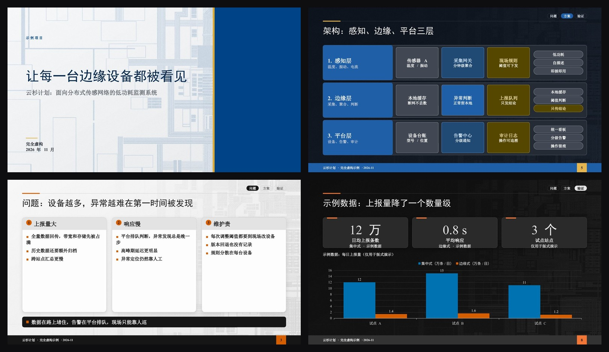
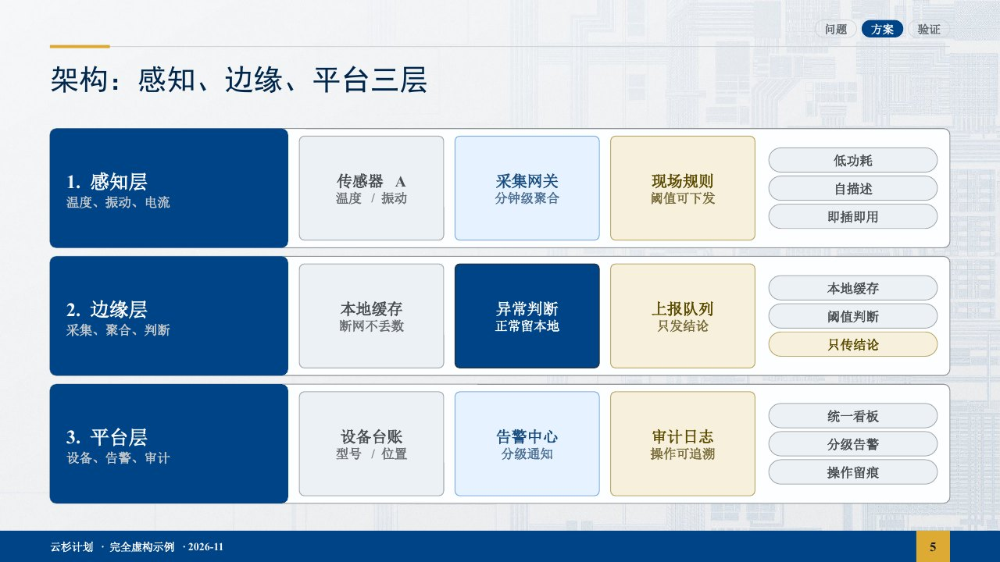

<div align="center">

# PowerPresent

**让 Agent 做出不像 AI 做的 PPT。**

可编辑 PPTX · 两套配色 · 六种底图 · 图示与真实素材优先

[](https://github.com/PlutoKeating/Project.PowerPresent/releases) [](LICENSE) [](https://www.python.org/) [](https://github.com/PlutoKeating/Project.PowerPresent) [](https://github.com/PlutoKeating/Project.PowerPresent)

[快速开始](#快速开始) · [看效果](#看效果) · [设计系统](#设计系统) · [示例](#示例)

</div>



> 不是“帮你排版”，而是把 **听众、叙事、证据、视觉、交付** 串成一条可复用的 PPT 生产线。

## 为什么又做了一个 PPT skill？

因为大多数 AI PPT 都在解决“怎么快速生成一页”，而不是“怎么让一页讲清楚一件事”。

| 常见的 AI PPT | PowerPresent |
|---|---|
| 模板感、渐变、发光、玻璃卡片 | 两套有出处的配色、六种低对比度底图 |
| 标题写“背景”“方案”，听完不知道结论 | 每页标题是一句完整的结论 |
| 满屏要点，复杂内容还是文字 | 架构、链路、机制优先画成图 |
| 导出图片，改一个字都不行 | 原生可编辑 PPTX，文字、形状、图表都能改 |

## 它能做什么

| | |
|---|---|
| **七步工作流** | 从听众和一句话目标，到提纲、配图、构建、逐页检查、交付 |
| **两套配色** | `journal` 学术（期刊蓝 + 赭黄）、`ink` 商业（墨 + 朱） |
| **六种底图** | `wafer`（默认）、`brushed`、`blueprint`、`dots`、`contour`、`hairline` |
| **组件库** | 卡片、数据块、图表、表格、步骤、时间线，以及分层全景、运行链路、2.5D 层叠等 |
| **可编辑交付** | 可编辑 PPTX 是唯一权威产物；预览图只用于自检 |
| **真实素材优先** | 图示、截图、实拍、数据图加对照说明，不靠要点堆满页面 |

## 看效果



- [云杉计划 · 完全虚构示例 · 11 页 PPTX](examples/demo/out/demo-journal-light.pptx)
- [四套模板预览](examples/demo/out/preview/)
- [生成脚本](examples/demo/build.py)

## 快速开始

### 1. 安装 skill

```bash
git clone https://github.com/PlutoKeating/Project.PowerPresent.git
cd Project.PowerPresent

# Claude Code
./skills/powerpresent/install.sh --claude

# OpenCode
./skills/powerpresent/install.sh --opencode

# 或者只装到某个项目
./skills/powerpresent/install.sh --project /path/to/your-project
```

### 2. 安装依赖

```bash
python -m pip install -r <skill 目录>/requirements.txt
```

还需要本机安装 LibreOffice（`soffice`）和 poppler（`pdftoppm`），用于把 PPTX 渲染成逐页预览。生成图片（可选）另需 `google-genai` 与已登录的 `gcloud`。

### 3. 对 Agent 说

```text
用 powerpresent skill 做一份 <主题> 的 <学术汇报/产品路演>：
听众是 <...>，<...> 分钟，约 <...> 页，<journal/ink> + <light/dark> + <read/talk>，底图 <wafer>。
材料在 <...>。先给主旨句和每页标题提纲，我确认后再做可编辑 PPTX 并逐页预览；不要编造数据。
```

> [!TIP]
> 如果 Agent 没有自动识别 skill，直接点名 `powerpresent`，或者把 `SKILL.md` 的绝对路径发给它。

### 4. 验收

```bash
python build.py
python <skill 目录>/scripts/render_pptx.py out/deck.pptx out/preview
```

> [!NOTE]
> 预览由 LibreOffice 渲染，字体、间距和阴影与 PowerPoint、WPS 会有差异；最终以目标软件里的人眼确认为准。

## 七步工作流


第 3 步会停下来等你确认提纲。改提纲比改页面便宜得多。

## 设计系统

| 场景 | 配色 | 底色 | 密度 | 推荐底图 |
|---|---|---|---|---|
| 学术会议 / 答辩 | `journal` | `light` | `read` / `talk` | `blueprint` / `wafer` |
| 产品发布 / 路演 | `ink` | `dark` | `talk` | `wafer` / `brushed` |
| 商业提案 / 企业介绍 | `ink` | `light` | `read` | `dots` / `hairline` |

底图共六种：`wafer`（默认，芯片版图）、`brushed`（粗拉丝）、`blueprint`（制图网格）、`dots`（点阵）、`contour`（等高线）、`hairline`（斜线）。

<details>
<summary><strong>已确认的项目决策（硬性约束）</strong></summary>

- **交付格式**：可编辑 PPTX 唯一权威产物；文字、形状、图表保持原生可编辑。
- **视觉**：不用发光、渐变文字、粒子或光斑背景、玻璃卡片、标题竖条。
- **配色**：只有 `journal` / `ink` 两套，各含深浅两种底色；颜色在 OKLCH 感知均匀空间按固定规则派生，不凭感觉配色。
- **明暗层次**：每个内容页要有底、反色块（标题头带、数据块、表头、页脚带等）和小面积强调色三层。
- **文字**：删次要文字（重复信息、读图提示、装饰标签），保留有实质内容的解释；一页非得靠提示才看懂就改布局。
- **字体**：西文与数字 Times New Roman；汉字大标题不加粗黑体，其余加粗宋体。
- **内容**：标题是结论；复杂内容画成图；技术稿的图示与真实图片页合计占内容页一半以上；数据、截图、引文必须真实。
- **图示**：2D 用纯色卡片加描边、不加阴影和光效；2.5D 用半透明卡片加阴影和柔光、不加描边；页面框架与内容卡片不用光效。
- **文字密度**：`read` / `talk` 两档；页数约等于分钟数，每页讲 1–2 分钟。
- **验收**：以 PowerPoint / WPS 里的人眼逐页确认为准，不用脚本化数值指标。
- **参考素材**：原始参考素材仅用于内部方法研究，已从仓库、git 历史与 release 中移除；仓库内不复刻任何原始页面。
- **图像生成**：只用于封面气氛图；不用于内容页背景，不生成冒充真实的截图或数据图。
- **文档语言**：中文；PPT 文案支持中文、英文和中英混排。

完整规则见 [`design-system.md`](skills/powerpresent/references/design-system.md)、[`copywriting.md`](skills/powerpresent/references/copywriting.md)、[`narrative.md`](skills/powerpresent/references/narrative.md) 与 [`components.md`](skills/powerpresent/references/components.md)。

</details>

## 示例

| 示例 | 内容 | 打开 |
|---|---|---|
| 云杉计划 · 学术风 | 11 页完全虚构示例，`journal` 浅色 | [PPTX](examples/demo/out/demo-journal-light.pptx) · [预览](examples/demo/out/preview/) |
| 云杉计划 · 商业风 | 同一内容的 `ink` 深色版本 | [PPTX](examples/demo/out/demo-ink-dark.pptx) · [预览](examples/demo/out/preview/) |

示例中的项目名、场景、数字和结论全部为虚构，仅用于展示版式与组件，不对应任何真实项目。

## 目录结构

<details>
<summary>展开查看</summary>

```text
skills/powerpresent/       skill 本体：SKILL.md、四份指南、组件库、六种底图
examples/demo/             完全虚构的《云杉计划》示例（4 份模板 × 11 页）
tools/package_skill.py     构建 skill 与示例发布包
dist/                      发布包（不入库）
build/                     中间产物（不入库）
```

</details>

## 状态

**v1.0.2** · 已发布

- 设计系统、组件库、四套模板的完全虚构示例均已完成
- 安装脚本、核心包 / 示例包、双许可证已就绪
- 安全清理：旧示例、复刻页与原始参考内容已从仓库、git 历史与 release 中移除
- 变更见 [CHANGELOG](skills/powerpresent/CHANGELOG.md)

如果这套规范帮你少改了几版 PPT，点个 ⭐ 就是最好的支持。

---

代码 [MIT](LICENSE) · 文档、指南、幻灯片与视觉素材 [CC BY-NC 4.0](LICENSE-CC-BY-NC-4.0.txt)
